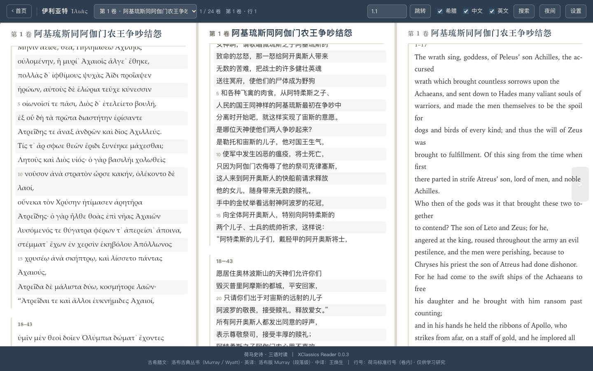
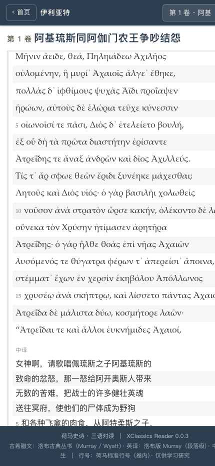

# XCReaderEpics · 荷马史诗三语对读阅读器

> XClassics 系列 · 离线单文件 HTML 阅读器，支持**古希腊语 / 英语 / 中文**三语逐段对照阅读《伊利亚特》《奥德赛》。

当前版本：**0.0.3**　·　单文件离线可用，无需安装、无外部依赖。


## 预览

三栏对读（桌面）：



窄屏自动切成按段卡片（同一段落三语紧邻，不再纵向堆叠三整栏）：



## 特性

- **三语并排对照**：古希腊原文（洛布底本）、英译（Loeb A. T. Murray 底本）、中译（王焕生）按荷马标准行号做段落级对齐。
- **完全离线**：单个 HTML 文件，无外部依赖、无网络请求，双击即读。
- **窄屏按段卡片**：视口 ≤880px 自动改为每个段落一张卡片，希腊语/英译/中译上下相邻，手机上仍可对读。
- **标准引用跳转**：跳转框接受 `3.450`、`Γ 450`、`Il. 3.450`、`Od 9.366`——可跨卷、可跨史诗，并**精确落到该行**。
- **一键复制引用**：点击段落左侧的行号范围，复制 `Il. 3.450–455` 形式的引用。
- **希腊文免重音搜索**：输入 `μηνιν` 也能命中 `Μῆνιν`（自动做 Unicode 归一化，忽略重音、气号与词尾 ς/σ 差异），并附可点击的结果列表。
- **中译行号锚点**：中译栏每 5 行标注对应荷马行号，读中文时也知道在第几行。
- **位置指示**：顶栏实时显示「第 N 卷 · 行 M」。
- **阅读体验**：正文字号、希腊文字号、行距、中文字体、希腊文字体均可调；三栏宽度可拖拽并记忆。
- **打印友好**：打印时自动隐藏界面、只输出当前卷，并切为按段卡片（三语相邻）。
- **导入模式**：独立版 `XC_Reader(Epic)_0.0.2.html` 支持上传自己的 JSON 数据，无需内嵌任何文本。

## 快速开始

### 方式一：直接阅读（已内嵌全文）
用浏览器打开 `荷马史诗三语对读.html` 即可，全部 48 卷文本已内嵌，可离线使用。

### 方式二：导入自己的文本（不携带受版权译文）
用浏览器打开 `XC_Reader(Epic)_0.0.2.html`，点击上传 `伊利亚特.json` / `奥德赛.json`（或你自己准备的合规文本）。

### 方式三：自行构建
1. 准备 `伊利亚特.json` / `奥德赛.json`（数据结构见 `总索引与来源说明.json`）。
2. 运行 `python3 build_reader.py`，会把两份 JSON 内嵌进 `reader_template.html`，生成 `荷马史诗三语对读.html`。

```bash
python3 build_reader.py
```

## 快捷键

| 按键 | 作用 |
| --- | --- |
| `←` / `→` | 上一卷 / 下一卷 |
| `j` / `k` | 下一段 / 上一段（`Shift` 一次三倍） |
| `g` / `G` | 第一卷 / 最后一卷 |
| `/` 或 `⌘F` | 打开搜索 |
| `Enter` / `Shift+Enter` | 搜索中：下一条 / 上一条 |
| `Esc` | 关闭搜索 / 设置 / 折叠菜单 |

跳转框还接受 `3.450`、`Γ 450`、`Il. 5.20`、`Od 9.366` 等写法。

## 目录结构

```
XCReaderEpics/
├── 荷马史诗三语对读.html        # 已构建、内嵌全文的阅读器（开箱即用）
├── XC_Reader(Epic)_0.0.2.html  # 独立阅读器（上传模式，不含文本，早期 UI）
├── reader_template.html        # 构建模板（含 __EPIC_DATA__ 占位符）
├── build_reader.py             # 构建脚本：把 JSON 内嵌进模板
├── 伊利亚特.json               # 伊利亚特 24 卷三语数据
├── 奥德赛.json                 # 奥德赛 24 卷三语数据
├── 总索引与来源说明.json        # 卷目索引、来源与质量说明
├── docs/                       # README 预览图
├── LICENSE                     # 阅读器代码 MIT 许可证
└── NOTICE                      # 文本版权声明（重要，请阅读）
```

## 数据来源与版权

本仓库中的**文本译文**来自第三方，仍受版权保护。请务必先阅读 [NOTICE](NOTICE)：

- **古希腊语原文**：公有领域（古代文献）。
- **英译**：Loeb Classical Library（A. T. Murray 底本，洛布版后经 W. F. Wyatt / G. E. Dimock 修订）© Harvard University Press。
- **中译**：王焕生（人民文学出版社）。
- **阅读器程序代码**：以 MIT 许可证发布（见 [LICENSE](LICENSE)）。

## 已知情况

- `荷马史诗三语对读.html` 是当前维护的界面（0.0.3）。`XC_Reader(Epic)_0.0.2.html` 是早期上传版，界面未同步上述改进；若需要一致的体验，可用 `reader_template.html` 自行构建。
- 希腊文底本用 `᾿`（U+1FBF）作为撇号，复制到 Word 等软件时可能需要替换；搜索已做归一化，不受影响。

## 版本历史

### 0.0.3
- 修正希腊文字体栈：原 `Palatino Linotype` / `GFS Didot` 在 macOS 均不存在，实际一直渲染为 Times New Roman；改为 Palatino / Hoefler Text / Baskerville 可选。
- 希腊文独立字号与更宽行距；英文栏启用 `hyphens`；正文测量宽度限制在 34em。
- 提升对比度至 WCAG AA（辅助文字 3.66 → 5.27，行号 2.25 → 4.63）。
- 窄屏（≤880px）改为**按段落卡片**：同一段落希/英/中紧邻；顶栏 237px → 51px。
- 跳转支持 `3.450` / `Γ 450` / `Il. 3.450` / `Od 9.366`，可跨卷跨史诗并精确落到该行。
- 点击行号范围复制 `Il. 3.450–455` 形式引用；顶栏实时显示「第 N 卷 · 行 M」。
- 中译栏每 5 行生成荷马行号锚点（共 3133 处）。
- 搜索做 Unicode 归一化：`μηνιν` 可命中 `Μῆνιν`，并新增结果列表。
- 修复：进度条压在顶栏上；切换语言重置栏宽；行号输入框 Enter 触发两次跳转；翻卷箭头不可聚焦；深色主题下拉配色。
- 打印时隐藏界面、限定当前卷并切为按段卡片。

### 0.0.2
- 首个公开版本：三语对读、卷章导航、上传模式、构建脚本。

## 免责声明

译文文本仅随阅读器一并提供，供个人学习、研究与非商业性使用。若需转载、公开分发或商业使用，请自行取得版权方授权。本仓库不对文本数据的再分发合法性负责；使用者应确保其使用符合所在司法管辖区的法律（如合理引用 / fair use）。

---

Made with XClassics · 仅供学习研究使用
